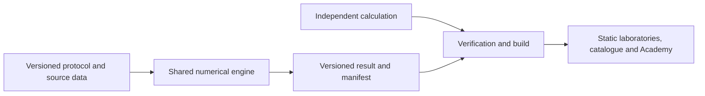

# SYNAPSE demonstration and portfolio brief

SYNAPSE is an independent research and education programme that the owner conceived and directed. AI tools materially assisted literature discovery, mathematical implementation, software and documentation. Automated checks and separately implemented computational references have been run. Human peer review and independent external replication are pending.

The site combines versioned synthetic experiments, established mathematical demonstrations, official economic and historical calculations, and openly documented modelling limits. The contribution is a research implementation and reproducible evidence environment, with no academic affiliation or credential implied.

## A five-minute visit

1. [Open the research atlas](https://neilmeher.github.io/synapse-research/#map). Follow changing relationship types from cognition and scientific reliability to economic scenarios.
2. [Change the ECHO dependence law](https://neilmeher.github.io/synapse-research/#robustness). Observe why matched pairwise correlation can leave different group outcomes.
3. [Inspect misleading evidence in MIRAGE](https://neilmeher.github.io/synapse-research/mirage.html). Compare confidence calibration with first-order answers, then open the inconclusive NOESIS result in the evidence library.
4. [Trace construction procurement through NEXUS](https://neilmeher.github.io/synapse-research/nexus.html). Separate the accelerator import, domestic production and facility's operating cash flows.
5. [Open CHRONOS](https://neilmeher.github.io/synapse-research/chronos.html). Compare tonne volume and tonne-km. Open the official source locator and change a synthetic causal assumption.
6. Start a reproduction from the [research catalogue](https://neilmeher.github.io/synapse-research/library.html). Pick a study, inspect its protocol and archived result, and find the relevant Academy prerequisite.

[Findings and limitations](programme-quality-register.md) · [Reproduction commands](../REPRODUCIBILITY.md) · [Upcoming research](future-empirical-programme.md)
